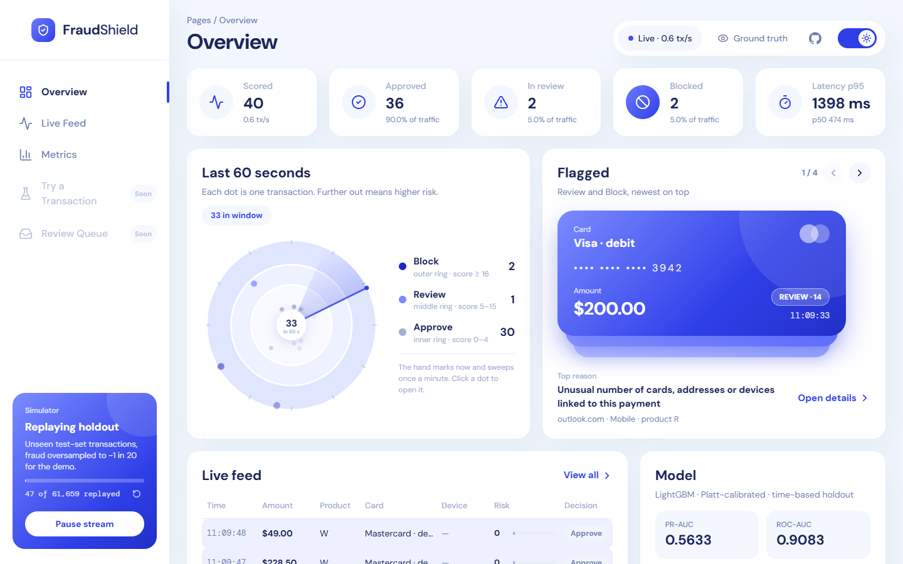
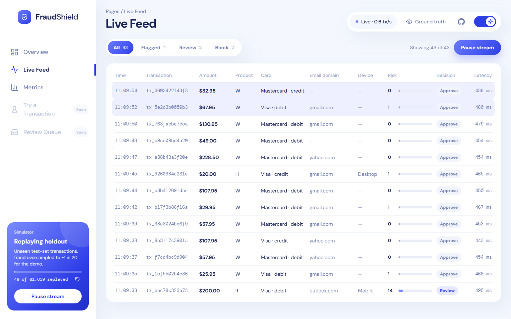
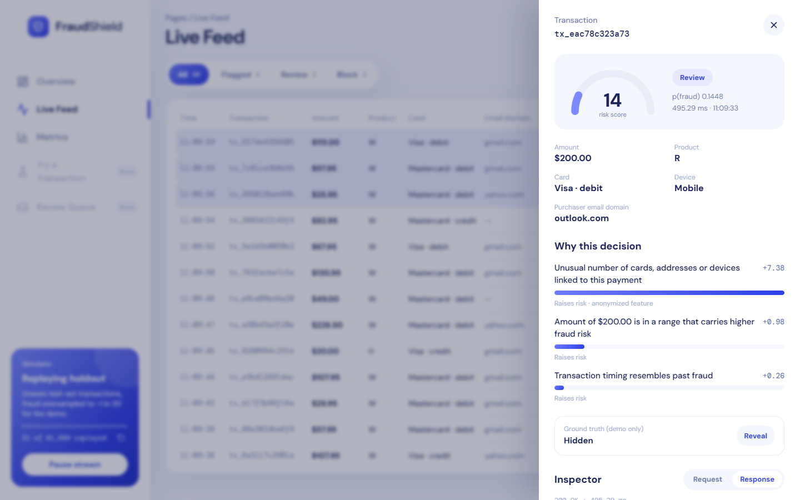
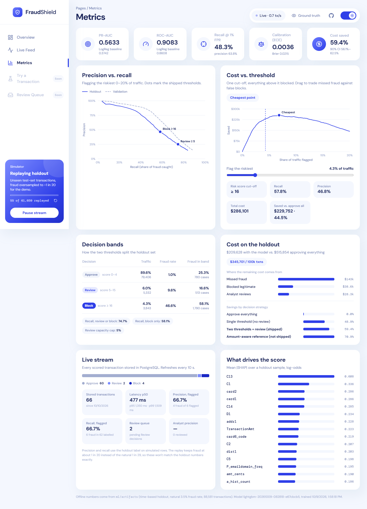
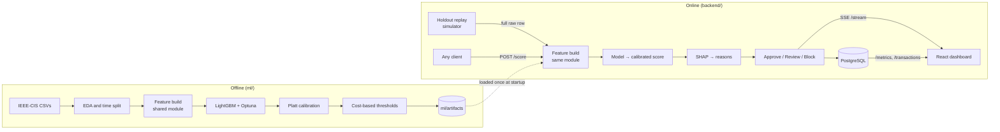

<div align="center">

# FraudShield

**Real-time fraud scoring for payment transactions. Every decision comes with its reasons.**

A full ML system on the IEEE-CIS dataset: leakage-safe feature engineering, a calibrated LightGBM model, cost-optimised Approve / Review / Block thresholds, per-transaction SHAP explanations, a FastAPI scoring service with PostgreSQL and live streaming, and a custom React dashboard.


**[Demo video](https://YOUR-DEMO-VIDEO-LINK)** · [Live demo](https://fraud-shield-ai-gold.vercel.app/) · [API docs](https://fraudshield-ai-f2eca.containers.snapdeploy.app/docs) · [How it works](#how-it-works) · [Results](#results)

<sub>The live demo runs on a free tier that sleeps when idle: the first visit takes a minute or two to wake the server, and scoring is slower than on a full CPU. The video shows the full experience.</sub>

<!-- Replace the demo video link once the video is uploaded. -->



</div>

---

## Why this project

Most fraud projects stop at a notebook and an accuracy score. With 3.5% fraud, a model that approves everything is already 96.5% "accurate", so accuracy says nothing. FraudShield treats fraud detection as a **system**:

- **Time-aware.** Trained on the past, validated on the next month, tested once on the final month. No random shuffling.
- **Leakage-safe.** Every per-card aggregate uses only transactions strictly before the one being scored.
- **One feature module for training and serving.** The API reproduces the offline holdout scores **bit for bit**, and a test enforces it.
- **Business-aware decisions.** Thresholds come from a cost model (missed fraud vs. false blocks vs. analyst time), not a default 0.5.
- **Explainable.** Every score ships with its top SHAP drivers, mapped to plain-language reasons.
- **Served, not just trained.** FastAPI, PostgreSQL, Server-Sent Events, a holdout replay simulator and a live dashboard.

## Results

All numbers are on the **untouched time-based holdout** (88,581 transactions, natural 3.48% fraud rate), evaluated once.

| Metric | LightGBM (shipped) | Logistic regression baseline |
|---|---|---|
| **PR-AUC** | **0.5633** | 0.3742 |
| **ROC-AUC** | **0.9083** | 0.8608 |
| **Recall @ 1% FPR** | **48.3%** | 31.9% |
| Precision at the validation-chosen threshold | 55.8% (recall 52.6%) | 41.7% |
| Calibration | Brier 0.0215 · ECE 0.0036 | |

**Decisions and cost** (two thresholds, chosen on validation, applied to holdout):

| Band | Risk score | Share of traffic | Fraud rate in band | Share of all fraud |
|---|---|---|---|---|
| ✅ Approve | 0–4 | 89.6% | 1.0% | 25.3% |
| 🟡 Review | 5–15 | 6.0% | 9.6% | 16.6% |
| 🔴 Block | ≥ 16 | 4.3% | 46.6% | 58.1% |

- **59.4% lower fraud-related cost** than approving everything: $306k saved on the holdout, or about $346k per 100k transactions. The 90% bootstrap CI is 56.1%–62.5%.
- Review + Block catches **74.7%** of fraud while sending only **6%** of traffic to analysts (capped at 5% on validation).
- Two thresholds with a review band beat a single block threshold: 59.4% vs. 48.9% savings.

## Screenshots

| Live feed | Transaction detail |
|---|---|
|  |  |

<details>
<summary><b>Metrics page</b> (PR curve, cost-vs-threshold slider, decision bands, live accuracy, SHAP importance)</summary>



</details>

## How it works



### 1. Data and split

[IEEE-CIS Fraud Detection](https://www.kaggle.com/c/ieee-fraud-detection): 590,540 transactions joined with the identity table (which covers 24% of them), 3.5% fraud. The split is by `TransactionDT`: **train** to day 120, **validation** to day 152, **holdout** after that. The holdout is used only for the final evaluation and the live simulator.

### 2. Feature engineering (`backend/app/features/`)

The dataset has no card ID, so card identity is reconstructed:

- **Key A** (card group): `card1–6 + addr1–2`
- **Key B** (card): Key A + an anchor day, `floor(day − D1)`. In EDA, `D1` behaves like "days since the card's first activity".

A `CardHistoryStore` processes transactions in time order and computes 17 stateful features **before** adding each transaction to history:

- **Velocity:** counts over 10 min / 1 h / 24 h, amount sums, time since the previous transaction
- **Behaviour:** amount relative to the card's historical mean
- **Novelty:** first time this device / email domain / address is seen with the card

Those sit alongside stateless features (log amount, cents, relative hour and weekday, email match, missingness counts) and encoders fit on train only (integer codes for low-cardinality columns, frequency encoding for high-cardinality ones). That gives **434 features** in total. Training and serving call the same functions, so there is no skew by construction.

### 3. Model

LightGBM tuned with Optuna (2,316 trees, 200 leaves), handling class imbalance through `scale_pos_weight` rather than SMOTE. It beat XGBoost on validation PR-AUC (0.646 vs. 0.609) and fit 4× faster. Platt scaling on the logit turns the output into a calibrated probability, so the 0–100 risk score means something.

### 4. Decisions

A cost model prices each outcome: missed fraud costs the amount plus a $15 chargeback fee, a false block costs margin and friction, and each review costs analyst time. Two thresholds were searched on validation with review volume capped at 5% of traffic. That produced **Review at risk score 5** and **Block at 16**.

### 5. Explanations

SHAP values are computed per request with LightGBM's built-in TreeSHAP (`pred_contrib`, identical to `shap.TreeExplainer`). A reason map turns the top contributors into readable text, for example *"3 earlier transaction(s) on this card in the last 10 minutes"* or *"Card was dormant for 31 days before this transaction"*. At most one reason comes from an anonymised feature, and there is a fallback when no contributor clears the threshold.

### 6. Serving

- FastAPI loads the model, calibrator, encoders, thresholds and reason map **once** at startup.
- `POST /score` and the simulator share **one scoring path**.
- Every scored transaction is written to PostgreSQL asynchronously and broadcast over SSE.
- The **simulator** replays the holdout with fraud oversampled to about 1 in 20, so flagged transactions appear quickly. Every skipped row still goes through the card-history store, so features and scores match the offline evaluation exactly. Pause / Resume keeps its place, and Rewind rebuilds the history.

## Dashboard

React 18 + TypeScript + Vite, Tailwind CSS and Chakra UI, with light and dark themes.

| Page | What it shows |
|---|---|
| **Start → boot pipeline** | Checks the API, model, PostgreSQL and SSE stream step by step, with retry on failure |
| **Overview** | Live counters and latency, a 60-second "pulse ring" where distance from the centre is risk, a stack of flagged cards, the latest transactions and a model summary |
| **Live Feed** | Filterable stream (All / Flagged / Review / Block), with an optional ground-truth column |
| **Transaction detail** | Score gauge, reasons with SHAP contributions, ground-truth reveal, and the raw request / response JSON |
| **Metrics** | Holdout KPIs, precision–recall curve with the shipped thresholds, cost-vs-threshold slider, decision bands, cost breakdown and strategy comparison, live stream precision / recall / latency from PostgreSQL, global SHAP importance |

Set `VITE_DATA_SOURCE=mock` to run the dashboard with no backend at all. An in-browser generator emits the same event shape.

## API

Interactive docs are at `/docs` (Swagger) and `/redoc`.

| Method | Endpoint | Description |
|---|---|---|
| `GET` | `/health` | Model status, version, tree and feature counts |
| `GET` | `/health/db` | PostgreSQL check (`SELECT 1`), returns 503 when it's down |
| `POST` | `/api/v1/score` | Score one transaction: risk score, decision, reasons, latency |
| `GET` | `/api/v1/stream` | Server-Sent Events: every scored transaction |
| `POST` | `/api/v1/simulate/start` · `stop` · `reset` | Start / resume, pause, rewind the holdout replay |
| `GET` | `/api/v1/simulate/status` | Replay progress |
| `GET` | `/api/v1/transactions` | History with decision / amount filters and pagination |
| `POST` | `/api/v1/transactions/{id}/review` | Analyst label: `FRAUD` or `FALSE_POSITIVE` |
| `GET` | `/api/v1/metrics` | Live stream stats plus the offline evaluation (curves, bands, cost, SHAP) |

<details>
<summary>Example request and response</summary>

```http
POST /api/v1/score
Content-Type: application/json

{
  "TransactionAmt": 912.50,
  "ProductCD": "W",
  "card1": 9500,
  "card4": "visa",
  "card6": "credit",
  "addr1": 315,
  "P_emaildomain": "protonmail.com",
  "DeviceType": "mobile",
  "what_if": true
}
```

```json
{
  "transaction_id": "tx_8b832fb1f8c1",
  "score": 4,
  "decision": "APPROVE",
  "reasons": [
    { "text": "Unusual number of cards, addresses or devices linked to this payment", "contribution": 3.21, "kind": "anonymized" },
    { "text": "Purchaser email domain is rare or has never been seen before", "contribution": 1.333, "kind": "specific" },
    { "text": "Card type carries elevated fraud risk in past data", "contribution": 0.369, "kind": "specific" }
  ],
  "calibrated_prob": 0.0474,
  "raw_score": 0.001146,
  "latency_ms": 460.85,
  "what_if": true
}
```

Every field is optional except `TransactionAmt`. The schema also accepts the anonymised `C`, `D`, `V` and `id_*` columns. `what_if: true` scores without recording the transaction in card history. Contributions are SHAP values in log-odds. A brand-new card has no history, so this one stays just under the review cut-off despite the risky signals.

</details>

## Getting started

**Prerequisites:** Python 3.11+, Node 18+, Docker, and a Kaggle account (the dataset requires accepting the competition rules).

```bash
# 1. Clone and install
git clone https://github.com/AkshatJ24/FraudShield-AI.git
cd FraudShield-AI
python -m venv .venv
.venv\Scripts\activate          # macOS / Linux: source .venv/bin/activate
pip install -r requirements.txt
cp .env.example .env

# 2. Data: put train_transaction.csv and train_identity.csv in data/raw/
kaggle competitions download -c ieee-fraud-detection -p data/raw
unzip data/raw/ieee-fraud-detection.zip -d data/raw

# 3. Build features and artifacts: run the notebooks in order
#    ml/notebooks/01_EDA → 02_Feature_Engineering → 03_Modeling → 04_Thresholds_and_Explainability
#    (writes data/processed/*.parquet and ml/artifacts/*.json)

# 4. Database
docker compose up -d db
cd backend && alembic upgrade head

# 5. API (from backend/)
uvicorn app.main:app --port 8000

# 6. Dashboard (new terminal)
cd frontend
cp .env.example .env
npm install
npm run dev
```

Open **http://localhost:5173** and click **Start / Test**. The first start takes about 30 s while the simulator loads the replay set and warms the card history.

### Tests

```bash
cd backend
pytest -q
```

The 36 tests cover feature leakage and training/serving parity, schema validation, decision bands, the API and persistence. There is also an end-to-end check that the simulator reproduces the offline holdout scores exactly. The data-dependent tests are skipped when the local data files aren't present.

> **Note:** the tests use the database in `.env`, and `test_pagination` clears the `transactions` table.

## Deployment

| Part | Platform | Notes |
|---|---|---|
| Dashboard | **Vercel**: [fraud-shield-ai-gold.vercel.app](https://fraud-shield-ai-gold.vercel.app/) | Root directory `frontend`, env `VITE_API_URL` = the API URL |
| API | **SnapDeploy** (Docker, from GitHub): [API docs](https://fraudshield-ai-f2eca.containers.snapdeploy.app/docs) | Builds the root `Dockerfile`; port `7860`; secret `DATABASE_URL` |
| Database | **Neon** (serverless Postgres) | Paste the connection string as the `DATABASE_URL` secret, as-is |

The API image holds the model artifacts and a 20 MB replay set (`data/replay/`, built with `python -m app.api.simulator --export`) instead of the 800 MB of raw CSVs and the full feature table. The replay set has the holdout rows, read one chunk at a time, and a snapshot of card history for just the cards the holdout uses. Scores are unchanged, and a test checks they still match the offline holdout exactly.

The image runs in **about 300–400 MB of RAM** on a 512 MB / 0.25 vCPU free tier:

| | Full CPU | 0.25 vCPU |
|---|---|---|
| Startup (model load + migrations) | ~10 s | ~20 s |
| Scoring one transaction | ~0.45 s | ~1.7 s |

It runs migrations on start. The simulator pauses itself after 5 minutes with no dashboard connected (`SIMULATOR_IDLE_PAUSE_S`). The dashboard keeps retrying for up to 3 minutes while a sleeping server wakes up.

## Project structure

```
├── backend/
│   ├── app/
│   │   ├── api/          # health, score, stream (SSE), simulator, transactions, metrics
│   │   ├── core/         # settings, model state (loaded once), calibrator, thresholds
│   │   ├── db/           # SQLAlchemy models, async session, CRUD
│   │   ├── features/     # shared feature code: keys, card history store, encoders, transforms
│   │   ├── schemas/      # Pydantic request / response models
│   │   └── services/     # scoring pipeline, SHAP reason mapping
│   ├── migrations/       # Alembic
│   └── tests/
├── frontend/             # React + TypeScript dashboard (see frontend/README.md)
├── ml/
│   ├── notebooks/        # 01 EDA · 02 features · 03 modeling · 04 thresholds & explainability
│   ├── training/         # train, evaluate, tune_thresholds, reasons
│   └── artifacts/        # model, calibrator, encoders, thresholds, reason map, curves
├── docs/                 # EDA / model / threshold figures, screenshots
├── data/                 # raw + processed (gitignored); replay/ = deployable replay set
├── Dockerfile            # API image
└── docker-compose.yml    # PostgreSQL
```

## Design decisions and limitations

- **Time-based split over random split.** It mirrors deployment, and a random split would leak future card behaviour into training.
- **Class weights over SMOTE.** Synthetic minority rows make little sense for time-ordered, per-card data.
- **Two thresholds and a review band.** Uncertain cases go to people instead of being forced into approve or block. That's worth about 10 points of savings.
- **Oversampled demo stream.** This is a presentation choice: the replay shows fraud at about 1 in 20 instead of 1 in 29. All reported metrics use the natural distribution.
- **Latency.** Model inference takes about 1 ms, but exact per-request SHAP over 2,316 trees brings the end-to-end time to about 450 ms. A production system would explain asynchronously or only for flagged transactions.
- **Heuristic card identity.** Key B is an EDA-derived approximation. The dataset has no true card ID.
- **Anonymised features.** Many of the strongest signals (C13, C1, the V columns) can't be described in business terms, so readable reasons use the interpretable subset.
- **In-memory card history.** This is fine for a single process. Scaling out would need a shared store such as Redis.
- **Portfolio project, not production.** Missing pieces include auth, PCI-DSS controls, model versioning and retraining on delayed labels.

## Roadmap

- [ ] **Try a Transaction:** a form with presets that scores through the same `/score` endpoint
- [ ] **Review Queue:** an analyst workflow on top of `/transactions/{id}/review`
- [ ] Drift monitoring (PSI on key features, train vs. recent serving data)
- [ ] Graph features: devices and addresses shared across cards
- [ ] JWT auth for review and admin endpoints
- [ ] Docker image for the API, CI, and a load test

## Acknowledgements

Data: [IEEE-CIS Fraud Detection](https://www.kaggle.com/c/ieee-fraud-detection), provided by Vesta Corporation and the IEEE Computational Intelligence Society. The raw data is not included in this repository.

## License

<!-- Add a LICENSE file (e.g. MIT) and update this section. -->
No license has been chosen yet.
